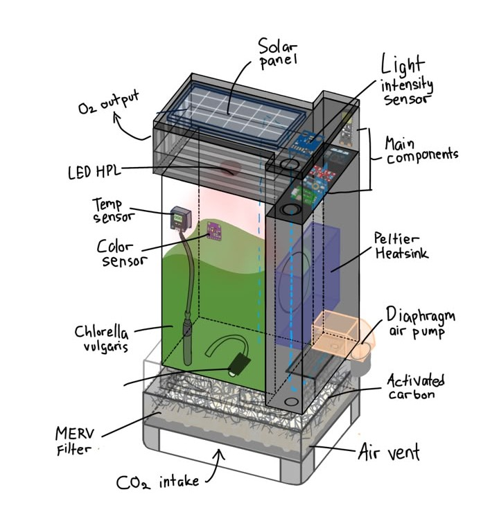

# PhotoSyntheAir - Algae-Based Smart Air Purifier
A smart hybrid bio-mechanical system for advanced air remediation that tranfom polluted air into cleaner air!

[Check out the demo vid!]()

## Features
- **ESP32-S3 Embedded Control System**: Coordinating sensors, automated controls, and communication with the monitoring website.
- **Multi-Sensor Data Acquisition**: Using TCS34725 color sensor to monitor algae color (health), DS18B20 water proof temperature sensor to measure algae temperature, and BH1750 light intesnity sensor to measure received sunlight for algae growth.
- **MOSFET-Based Actuator Switching**: Using IRLB8721 N-channel MOSFET to control high-current (TEC-12706 Peltier Cooling Module)
- **Web Monitoring**: Displaying sensor readings and system conditions on the website, alongside with alerts for potential algae health issues.
- **Temperature Regulation**: Activating TEC-12706 Peltier Cooling Module and heatsink fan when the algae's temperature hits the configurreed threshold (in this case I set to 30 degree celcius)
- **Off-Grid Power Supply**: Using solar panels and rechargable batteries as the primary power source.

## Background
Air pollution has become a growing environmental and public health concern here in Bandung, Indonesia, driven by vehicle emissions, industrial activities, and rapid ubran development. Unlike coastal cities, Bandung is an inland city with no direct sea breeze to help disperse air pollutants and release oxygen. Knowing that microalgae can produce more oxygen per unit area than trees under certain conditions due to their rapid growth and photosynthetic efficiency, they offer a promising approach to complement conventional air purification methods. To address Bandung's air pollution, this project proposes an Algae-Based Smart Air Purifier that combines multi-stage filtration with microalgae to absorb CO₂ through photosynthesis. Integrated with an ESP32-S3 microcontroller, sensors, automated temperature and lighting controls, and website monitoring, the system aims to maintain suitable algae growth conditions. Powered primarily by solar energy, this project explores a sustainable approach to air treatment in urban Bandung.

## How it works
The Algae-Based Smart Air Purifier fan draws polluted air through a MERV filter to capture airborne particles, followed by an activated carbon filter to help remove gaseous pollutants. The filtered air is then directed into an algae chamber, where microalgae absorb CO₂ through photosynthesis and release oxygen when sufficient light is available. An ESP32-S3 microcontroller collects data from the TCS34725 color sensor, DS18B20 temperature sensor, and BH1750 light intensity sensor to monitor algae conditions, automate cooling, and supplementary lighting. The data is displayed on the website, allowing users to track system performance and receive maintenance alerts. 

## Repository Structure
`/cad` Contains the 3D design files in `.step` format for the purifier's physical structure and component layout.
`/assets` Contains project images.
`/firmware` Contains the ESP32-S3 firmware source code for sensor data acquisition, automated system control, and web monitoring platform.
`bom.csv` Contains bill of materials for this project

## Bill of Materials (BOM)
[Click here for bill of materials](bom.csv)

## Hardware

## Schematic

## 3D Models

## Build Instruction

## Firmware setup
1. Open this folder in VS Code with the PlatformIO extension installed.
2. Edit `include/config.h`:
   - `WIFI_SSID`
   - `TELEGRAM_BOT_TOKEN` / `TELEGRAM_CHAT_ID` (see below)
   - Tune `ALGAE_GREEN_RATIO_MIN` / `ALGAE_SATURATION_MIN` / `DAYLIGHT_LUX_THRESHOLD` after a few days of real sensor logging (print raw values to Serial first).
3. **Upload the filesystem first** (PlatformIO sidebar → project tasks → your env → Platform → "Upload Filesystem Image"), so `data/index.html`, `style.css`, `script.js` land on LittleFS.
4. Then build & upload the firmware normally (Upload button / `pio run --target upload`).
5. Open the Serial Monitor at 115200 baud to see the assigned IP address, then browse to `http://<that-ip>/` from any device on the same network for the live dashboard.

### Telegram bot setup (phone notifications)
1. Message **@BotFather** on Telegram `/newbot`, copy the token into `TELEGRAM_BOT_TOKEN`.
2. Message **@userinfobot** to get **your** numeric chat ID, put it in `TELEGRAM_CHAT_ID`.
3. Send your new bot any message for testing (telegram requires the user to message the bot first before it can message back).
4. After that, you'll get a message every time the algae turns pale.

## Notes
- IRLB8721 is a **logic-level** MOSFET (fully on around 4.5V Vgs), so driving it straight from a 3.3V GPIO (through R2) is fine, no gate driver IC needed.
- The peltier alone can pull ~5A; make sure MOSFET1 has a small heatsink if it runs long stretches at that current and use wire gauge rated for 5A+ on the drain/source path.

## Common Mistakes

## Credits

The website also asks the browser for notification permission and will pop an in-browser notification for the same two events whenever the dashboard tab is open — Telegram is the one that reaches your phone even when the site is closed.
